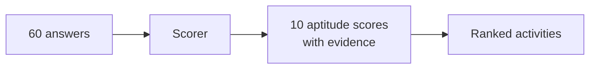

# TalentFinder

A Mac app that works out your natural aptitudes from a 60-question survey, then suggests the jobs, sports, hobbies and creative pursuits that suit them.

| Survey | Strengths and activities | Settings (⌘,) |
|---|---|---|
|  |  |  |

## Links

- [Instructions](docs/INSTRUCTIONS.md): setup, running and using the app
- [System Design](docs/SYSTEM-DESIGN.md): how it works and why
- [File Structure](docs/FILE-STRUCTURE.md): what's where
