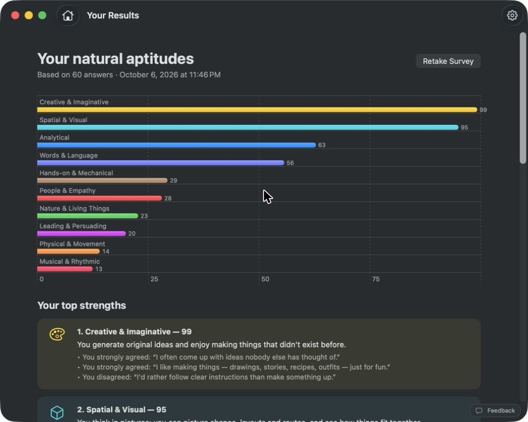
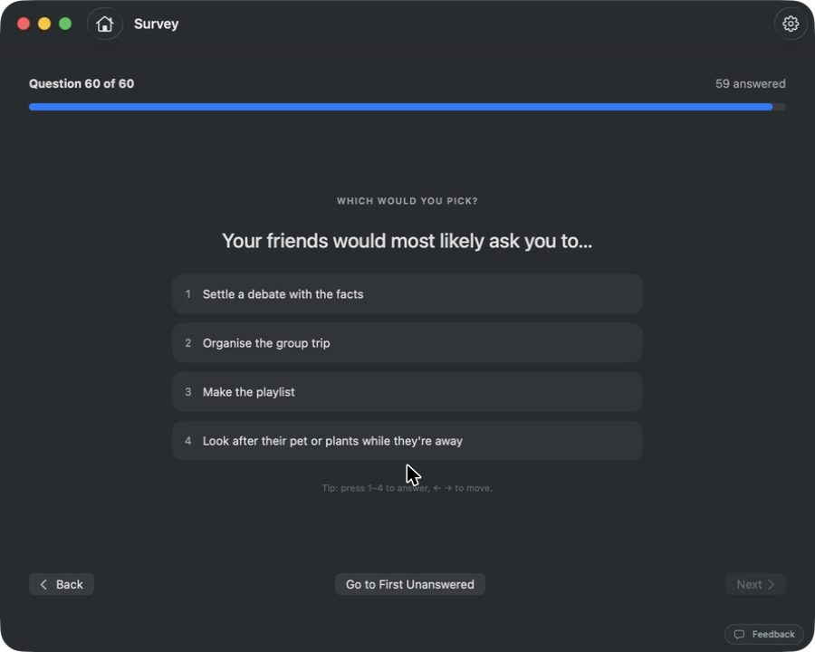
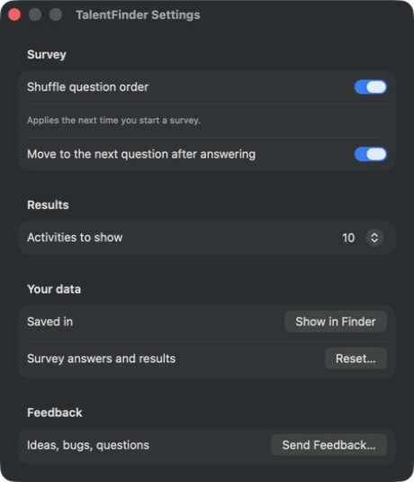
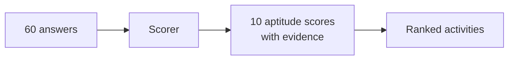

# TalentFinder

Find out what you're naturally good at. A 60-question survey scores ten aptitudes, then suggests the jobs, sports, hobbies and creative pursuits that suit them. It comes as a Mac app and as a website.

**[Try it in your browser →](https://amalmehta.github.io/TalentFinder/)**

| Survey | Strengths and activities | Settings (⌘,) |
|---|---|---|
|  |  |  |

| Website | On a phone |
|---|---|
|  |  |

## Links

- [Website](https://amalmehta.github.io/TalentFinder/)
- [Instructions](docs/INSTRUCTIONS.md): setup, running and using the Mac app and the website
- [System Design](docs/SYSTEM-DESIGN.md): how it works and why
- [File Structure](docs/FILE-STRUCTURE.md): what's where
