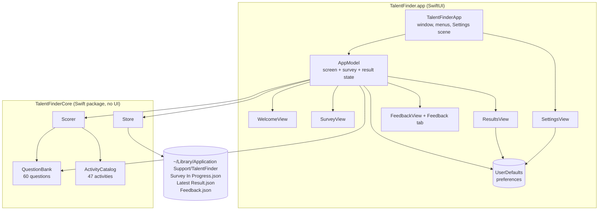

# System Design

TalentFinder is a native macOS app (SwiftUI, macOS 14+). The user answers a 60-question survey, and the app scores ten aptitudes and ranks 47 activities by how well they fit. Everything runs and stays on the Mac. There is no network access, no account and no API key.

## Architecture

## Components

| Component | Job |
|---|---|
| `Aptitude` | The ten aptitudes measured: name, SF Symbol and a plain-English description. |
| `Question` / `QuestionBank` | 60 questions in three kinds. **Agreement** items are rated from Strongly disagree to Strongly agree. **Ability** items are rated from Very hard to Very easy. **Choice** items ask "which would you pick?" with four options. Each scale item has weights per aptitude and may be reverse-keyed. Each choice option has its own weights. |
| `Activity` / `ActivityCatalog` | 47 activities in four categories (Work & Study, Creative, Sport & Movement, Hobbies), each with weights for the aptitudes it draws on. |
| `Scorer` | A pure function from answers to a `SurveyResult`. The result holds 0–100 scores per aptitude, up to three evidence lines each, and every activity ranked by fit with its top two reasons. |
| `Store` | Reads and writes the progress, result and feedback JSON files in one folder. Tests point it at a temporary folder. |
| `AppModel` | `@Observable` app state. It tracks the current screen, the survey in progress and the latest result. It starts, answers, moves, finishes and resets the survey, saves after every change and saves feedback. |
| Views | Welcome (start or resume), Survey (one question at a time, keys 1–5, arrow keys), Results (Swift Charts bar chart, strengths, filterable activity list), Settings (⌘,), and Feedback (a sheet opened from the corner tab, the Help menu or Settings). |

## Main flows

**Taking the survey.** Start Survey creates a `SurveyProgress` with all 60 question ids, shuffled if the setting is on. Each answer updates `answers[id]`, auto-advances if that setting is on, and saves `Survey In Progress.json`. If the app quits, Resume picks up at the same question.

**Scoring.** Once every question is answered, See My Results runs `Scorer.score`:

- **Scale items.** An answer *v* (1–5) becomes a level of (*v*−1)/4, flipped to 1−level for reverse-keyed items. Each aptitude earns *weight × level* and could have earned *weight*.
- **Choice items.** The chosen option earns its weight for each aptitude it lists. The most an aptitude could have earned is the highest weight any option gives it.
- **Aptitude score** = earned ÷ possible × 100. An aptitude with nothing to score is 0.
- **Evidence.** The answers that contributed most (scale levels above neutral, or chosen options), turned into short sentences.
- **Activity fit.** The weighted average of the aptitude scores the activity draws on. The reasons are the two aptitudes contributing the most.

The result is saved as `Latest Result.json` and the progress file is deleted.

**Settings.** The values are `@AppStorage` in UserDefaults, read when they matter: shuffle when a survey starts, auto-advance on each answer, and the activity count when results are drawn. Reset deletes the progress and result files and keeps feedback.

**Feedback.** The sheet appends `{date, kind, message}` to `Feedback.json`. Nothing is transmitted.

## Where data lives

| Data | Location |
|---|---|
| Survey in progress | `~/Library/Application Support/TalentFinder/Survey In Progress.json` |
| Latest result | `~/Library/Application Support/TalentFinder/Latest Result.json` |
| Feedback | `~/Library/Application Support/TalentFinder/Feedback.json` |
| Preferences | UserDefaults domain `com.amalmehta.TalentFinder` |
| Questions and activities | Compiled into the app (`QuestionBank.swift`, `Activity.swift`) |

## Key decisions and trade-offs

- **Local, rule-based scoring instead of AI.** Results are transparent, reproducible, testable and private, and work offline. The trade-off is that the written feedback comes from fixed descriptions plus the user's own answers, not a tailored narrative.
- **An original framework.** The ten aptitudes are loosely inspired by multiple-intelligences and interest (RIASEC-style) models, but the questions and weights are written for this app and have not been psychometrically validated. Results are worded as pointers, not verdicts.
- **A mix of question kinds.** Agreement, ability and forced-choice items reduce the pull to rate everything highly. One reverse-keyed item per aptitude catches straight-lining.
- **The core lives in a package separate from the UI.** All logic sits in `TalentFinderCore` and is tested with `swift test`, without launching the app. The app target only depends on it.
- **JSON files instead of SwiftData or Core Data.** The data is tiny, the files are readable, and there is no migration work. Only the latest result is kept.
- **XcodeGen with the generated project committed.** `project.yml` is the source of truth, but the `.xcodeproj` is committed so XcodeGen isn't needed just to build.
- **A Window scene instead of WindowGroup.** The app has a single main window, so ⌘N means "New Survey" rather than "new window".

## How it's tested

- **Unit tests** (`swift test`, 16 tests):
  - Question bank: 60 unique ids; five primary items and one reverse-keyed item per aptitude; every aptitude appears in at least three choice items; every aptitude has a matching activity.
  - Scorer: maxing out each aptitude ranks it first; reverse-keyed items work; all-neutral answers score 50; invalid answers are ignored; choices give full credit and evidence; matches follow strengths; quotes aren't doubled.
  - Store: progress and result round trips; reset keeps feedback; a shuffled order still covers every question.
- **Manual end-to-end run** of the built app, driven in the background through accessibility automation:
  - starting a survey and answering by click and by keyboard, with auto-advance
  - resuming a saved survey and finishing it to see the results
  - Settings from the menu, and saving feedback (checked in `Feedback.json`)

## Known limits

- The questions and weights are not psychometrically validated. Scores are relative indicators.
- Only the latest result is kept. There is no history or comparison over time.
- There is no export or sharing of results.
- English only. The text is hard-coded rather than localised.
- Feedback stays on the Mac. Someone has to open `Feedback.json` to read it.
- The app is ad-hoc signed and not notarised, so other Macs will show a Gatekeeper warning.
- There is no website version yet. It's planned as a separate step.
