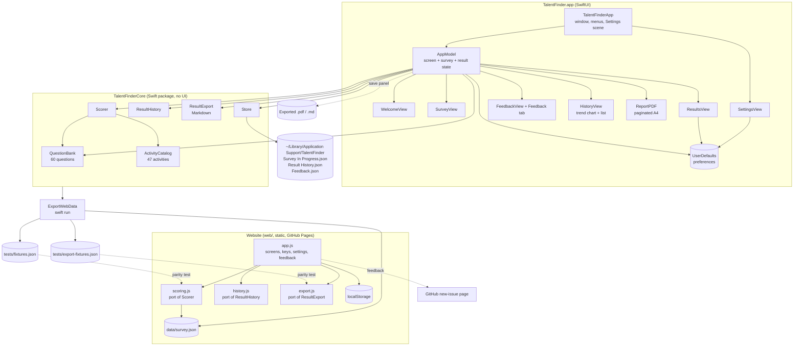

# System Design

TalentFinder comes as a native macOS app (SwiftUI, macOS 14+) and as a static website. In both, the user answers a 60-question survey, and the app scores ten aptitudes and ranks 47 activities by how well they fit. Everything runs and stays on the user's device. There is no server, no account and no API key. The Swift package is the single source of truth: the website loads JSON exported from it, and its scorer is a port that is tested to give identical results.

## Architecture

## Components

| Component | Job |
|---|---|
| `Aptitude` | The ten aptitudes measured: name, SF Symbol and a plain-English description. |
| `Question` / `QuestionBank` | 60 questions in three kinds. **Agreement** items are rated from Strongly disagree to Strongly agree. **Ability** items are rated from Very hard to Very easy. **Choice** items ask "which would you pick?" with four options. Each scale item has weights per aptitude and may be reverse-keyed. Each choice option has its own weights. |
| `Activity` / `ActivityCatalog` | 47 activities in four categories (Work & Study, Creative, Sport & Movement, Hobbies), each with weights for the aptitudes it draws on. |
| `Scorer` | A pure function from answers to a `SurveyResult`. The result holds 0–100 scores per aptitude, up to three evidence lines each, and every activity ranked by fit with its top two reasons. |
| `Store` | Reads and writes the progress, result history and feedback JSON files in one folder. On first load it moves an old single `Latest Result.json` into the history. Tests point it at a temporary folder. |
| `ResultHistory` | Pure operations on the history (kept oldest first): add (replacing a result with the same time), remove, one aptitude's series for the trend chart, and the change between the two newest results. |
| `ResultExport` | Turns a result into Markdown: scores (with a change column when there's a previous result), top strengths with evidence, and the top activities. Dates come in already formatted, so each platform uses the reader's locale while the rest of the text is identical. Also builds the suggested file name. |
| `AppModel` | `@Observable` app state. It tracks the current screen, the survey in progress, the result history, which past result is open, and which aptitudes the trend chart shows. It starts, answers, moves, finishes and resets the survey, opens and deletes past results, saves after every change and saves feedback. |
| Views | Welcome (start, resume, latest or past results), Survey (one question at a time, keys 1–5, arrow keys), Results (Swift Charts bar chart with ▲▼ change since last time, strengths, filterable activity list, and a banner when showing a past result), Past Results (trend line chart with aptitude chips, and the list with Open and Delete), Settings (⌘,), and Feedback (a sheet opened from the corner tab, the Help menu or Settings). |
| `ReportPDF` (app) | Builds the PDF export. Each section (header, score bars, each strength card, each activity row) is rendered with SwiftUI's `ImageRenderer` into a vector PDF context. Blocks are packed onto A4 pages so breaks fall between them, section headings stay with the block after them, and every page gets a footer with "Page n of m". |
| `WebExport` / `ExportWebData` | Encodes the aptitudes, questions and activities as `web/data/survey.json`. Also scores 21 answer sets (one favouring each aptitude, neutral, partial, invalid, empty and six seeded random sets) with the Swift `Scorer` and writes them to `web/tests/fixtures.json`. Writes four Markdown exports to `web/tests/export-fixtures.json`. |
| `web/js/scoring.js` | A line-for-line port of `Scorer`, with the same loop order, arithmetic and tie-breaks, so the floating-point results are bit-identical. It also creates new (optionally shuffled) survey progress. |
| `web/js/history.js` | A port of `ResultHistory`, plus moving a single result saved by an earlier website version into the history. |
| `web/js/export.js` | A port of `ResultExport`, with the same half-away-from-zero rounding as Swift. |
| `web/js/app.js` | The website: the same four screens as the Mac app, rendered from templates, plus keyboard handling, a Settings dialog (gear button or ⌘/Ctrl+,), the Feedback tab, and guarded `localStorage` persistence. |
| `.github/workflows/website.yml` | On pushes to `web/`, runs the parity, history and export tests, then publishes `web/` to GitHub Pages. |

## Main flows

**Taking the survey.** Start Survey creates a `SurveyProgress` with all 60 question ids, shuffled if the setting is on. Each answer updates `answers[id]`, auto-advances if that setting is on, and saves `Survey In Progress.json`. If the app quits, Resume picks up at the same question.

**Scoring.** Once every question is answered, See My Results runs `Scorer.score`:

- **Scale items.** An answer *v* (1–5) becomes a level of (*v*−1)/4, flipped to 1−level for reverse-keyed items. Each aptitude earns *weight × level* and could have earned *weight*.
- **Choice items.** The chosen option earns its weight for each aptitude it lists. The most an aptitude could have earned is the highest weight any option gives it.
- **Aptitude score** = earned ÷ possible × 100. An aptitude with nothing to score is 0.
- **Evidence.** The answers that contributed most (scale levels above neutral, or chosen options), turned into short sentences.
- **Activity fit.** The weighted average of the aptitude scores the activity draws on. The reasons are the two aptitudes contributing the most.

The result is added to the history, the history is saved to `Result History.json`, and the progress file is deleted.

**Past results.** A result is identified by its `completedAt` time. The results screen shows the open past result if there is one, otherwise the newest. When showing the newest, each bar also shows its change since the previous result. Past Results draws the chosen aptitudes as lines, one evenly spaced point per result, so retakes taken close together stay readable. Deleting asks first; deleting the last result returns to the welcome screen.

**Exporting.** Export works on the result on screen. Its "previous" is the result completed just before it, so a past result's change column compares against the one before it, and the oldest has none. The activity count follows the Settings value. The Mac app asks where to save with a save panel. The website downloads Markdown through a blob link. For PDF it calls `window.print()` after setting the page title to the file name, since browsers use the title as the suggested name. A print stylesheet hides the controls, forces light colours, adds a TalentFinder line at the top, and avoids page breaks inside cards and rows.

**Upgrading.** Earlier versions saved only `Latest Result.json` (or `talentfinder.result` on the website). On first load, that result becomes the first history entry and the old file or key is removed.

**Settings.** The values are `@AppStorage` in UserDefaults, read when they matter: shuffle when a survey starts, auto-advance on each answer, and the activity count when results are drawn. Reset deletes the progress and result files and keeps feedback.

**Feedback.** In the Mac app, the sheet appends `{date, kind, message}` to `Feedback.json`. Nothing is transmitted. On the website, the dialog opens `github.com/amalmehta/TalentFinder/issues/new`, with the title (`[Kind] first line`) and body filled in. The visitor reviews and submits it from their own GitHub account, so the site never sends anything itself.

**Website.** The page loads `data/survey.json`, then renders the welcome, survey or results screen. Progress, the result history and settings live in `localStorage` under `talentfinder.*` keys. Every read and write is wrapped so the site still works, in memory only, when storage is blocked. Saved progress that refers to questions that no longer exist is dropped on load.

**Keeping the two in step.** When the questions or activities change, run `swift run ExportWebData` to regenerate both JSON files. `swift test` fails if the committed files differ from what the Swift code would produce. `node --test web/tests/scoring.test.mjs` fails if the JS scorer's output differs from the Swift fixtures at all; the comparison is exact, not within a tolerance.

## Where data lives

| Data | Location |
|---|---|
| Survey in progress | `~/Library/Application Support/TalentFinder/Survey In Progress.json` |
| Result history | `~/Library/Application Support/TalentFinder/Result History.json` (oldest first) |
| Feedback | `~/Library/Application Support/TalentFinder/Feedback.json` |
| Preferences | UserDefaults domain `com.amalmehta.TalentFinder` |
| Questions and activities | Compiled into the app (`QuestionBank.swift`, `Activity.swift`), and exported to `web/data/survey.json` for the website |
| Website progress, history, settings | The visitor's browser `localStorage` (`talentfinder.progress`, `.history`, `.settings`) |
| Website feedback | GitHub Issues on amalmehta/TalentFinder, if the visitor submits it |

## Key decisions and trade-offs

- **Local, rule-based scoring instead of AI.** Results are transparent, reproducible, testable and private, and work offline. The trade-off is that the written feedback comes from fixed descriptions plus the user's own answers, not a tailored narrative.
- **An original framework.** The ten aptitudes are loosely inspired by multiple-intelligences and interest (RIASEC-style) models, but the questions and weights are written for this app and have not been psychometrically validated. Results are worded as pointers, not verdicts.
- **A mix of question kinds.** Agreement, ability and forced-choice items reduce the pull to rate everything highly. One reverse-keyed item per aptitude catches straight-lining.
- **The core lives in a package separate from the UI.** All logic sits in `TalentFinderCore` and is tested with `swift test`, without launching the app. The app target only depends on it.
- **JSON files instead of SwiftData or Core Data.** The data is tiny, the files are readable, and the only migration needed was a one-time move of the single saved result into the history.
- **Keep every result.** A result is a few kilobytes, so there's no cap; people delete entries or reset when they want.
- **Results are identified by completion time.** That avoids changing the saved result format, so old results still load. Two results can't realistically finish in the same second.
- **A trend chart rather than side-by-side comparison.** It shows direction across any number of retakes. The ▲▼ markers on the latest result cover the most common question: "what changed since last time?"
- **XcodeGen with the generated project committed.** `project.yml` is the source of truth, but the `.xcodeproj` is committed so XcodeGen isn't needed just to build.
- **A Window scene instead of WindowGroup.** The app has a single main window, so ⌘N means "New Survey" rather than "new window".
- **A plain static website instead of a framework or SwiftWasm.** There are no dependencies and no build step, the page loads fast, and it can be hosted anywhere. The cost is a second scorer to maintain, which the exported data and exact parity tests keep honest.
- **Exported JSON instead of copying the questions into JS.** Questions and activities are defined once, in Swift, and the website can't drift from the Mac app without a test failing.
- **Deterministic scoring order.** The Swift scorer walks aptitudes in a fixed order rather than dictionary order, and breaks ties by position. That makes results identical on every run and lets the JS port match them exactly.
- **Markdown defined once, ported once.** As with scoring, the Swift output is the reference and the JS output must match it exactly. Dates are passed in pre-formatted, so the match doesn't depend on locale or time zone.
- **A purpose-built PDF report on the Mac instead of printing the window.** The on-screen results are dark-mode aware and scroll; the report is always light, sized for A4, and never splits a card. Simple drawn bars replace the Swift Charts chart, so it renders the same way everywhere.
- **Print-to-PDF on the website instead of a PDF library.** No dependency, and the browser lays out the text. The cost is one extra step: the visitor chooses "Save as PDF" in the print dialog.
- **GitHub issues for website feedback.** It needs no backend and puts no email address on the page, and nothing is sent without the visitor's say. The cost is that a visitor needs a GitHub account to send feedback.

## How it's tested

- **Unit tests** (`swift test`, 29 tests):
  - Question bank: 60 unique ids; five primary items and one reverse-keyed item per aptitude; every aptitude appears in at least three choice items; every aptitude has a matching activity.
  - Scorer: maxing out each aptitude ranks it first; reverse-keyed items work; all-neutral answers score 50; invalid answers are ignored; choices give full credit and evidence; matches follow strengths; quotes aren't doubled.
  - Store: progress and result round trips; reset keeps feedback; a shuffled order still covers every question.
  - Web export: the committed `survey.json` and `fixtures.json` are current; scoring is deterministic.
  - History: oldest-first ordering and replacing a duplicate; removing; trend series and latest change; saving, loading and reset; moving an old single result into the history.
  - Export: the Markdown layout with and without a previous result; the change column and activity count; change markers, rounding and escaping table cells; the previous result and the file name; the export fixtures are current.
- **Website parity tests** (`node --test web/tests/scoring.test.mjs`, 24 tests): the JS scorer exactly matches all 21 Swift fixtures (scores, evidence, activity order, fits and reasons); it rejects invalid answers; a shuffled survey covers every question. **History tests** (`web/tests/history.test.mjs`, 4 tests) cover the same rules as the Swift history tests, including the migration. **Export tests** (`web/tests/export.test.mjs`, 7 tests) require the JS Markdown to equal the Swift Markdown exactly for four cases, and check rounding, change markers, the previous result and the file name. All three files run in CI before each deploy (35 tests).
- **Manual end-to-end run** of the built app, driven in the background through accessibility automation:
  - starting a survey and answering by click and by keyboard, with auto-advance
  - resuming a saved survey and finishing it to see the results
  - Settings from the menu, and saving feedback (checked in `Feedback.json`)
  - three results built up across relaunches; ▲▼ changes; Past Results chart, axis and chips (the choice is kept while navigating); opening a past result with its banner; deleting with confirmation
  - export: the Export menu and File menu items are present and disabled away from the results screen, and the save panel opens with the suggested name. The panel itself is a separate system process that automation isn't allowed to press, so the PDF was checked by running the real `ReportPDF` code in a small harness. Its output was checked with PDFKit at 5, 10, 15 and 25 activities (page count, text, change markers, footers, row count) and inspected visually.
- **Website end-to-end checks** in a browser, driving the real page's buttons and key handlers:
  - start, answer by click and by keyboard, go back, finish
  - results render, and the category filter works
  - settings save and apply; ⌘, opens Settings
  - the feedback link has the right title and body
  - resume works after a reload; reset clears progress and every result but keeps settings
  - export: Download Markdown produces the expected file name, type and text, matching the Swift output apart from dates; a past result exports without a change column when it's the oldest; Save as PDF calls print with the file name as the title
  - history: an old single result is migrated; results are kept oldest first; ▲▼ changes; the trend chart, chips and opening a past result; delete with confirmation; deleting the last result returns to the welcome screen
- **Visual checks** with headless Chrome, in light and dark mode at 1100 px and at phone width (390 px), with no horizontal overflow. The print stylesheet was checked with Chrome's own print-to-PDF from dark mode: light pages, no controls, no split cards.

## Known limits

- The questions and weights are not psychometrically validated. Scores are relative indicators.
- Exports are files you save yourself; there's no share link.
- The Markdown export has tables but no charts. The website's PDF needs the visitor to choose "Save as PDF" in the print dialog.
- English only. The text is hard-coded rather than localised.
- Feedback from the Mac app stays on the Mac; someone has to open `Feedback.json` to read it. Feedback from the website needs a GitHub account.
- The app is ad-hoc signed and not notarised, so other Macs will show a Gatekeeper warning.
- Results on the website live in one browser only and don't sync with the Mac app.
- In some browsers ⌘, opens the browser's own settings instead of TalentFinder's; the gear button always works.
- The website needs JavaScript and must be served over HTTP. Opening `index.html` from disk won't load the survey.
